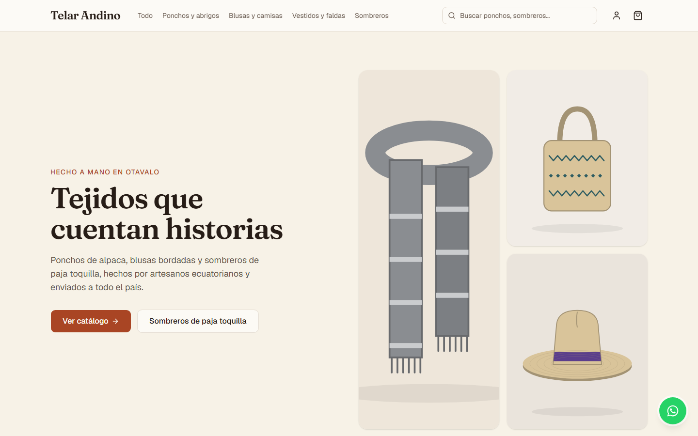
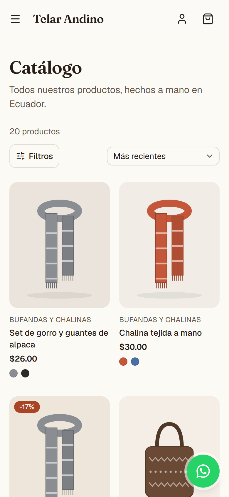
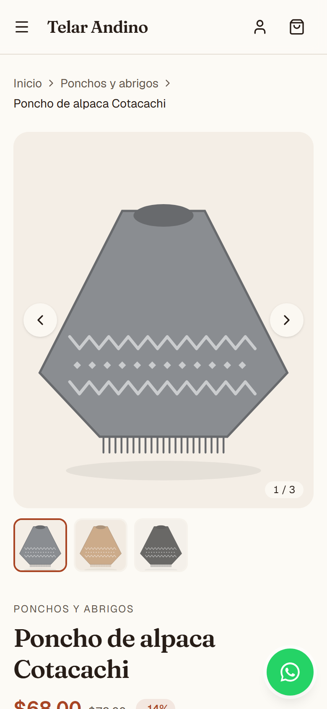
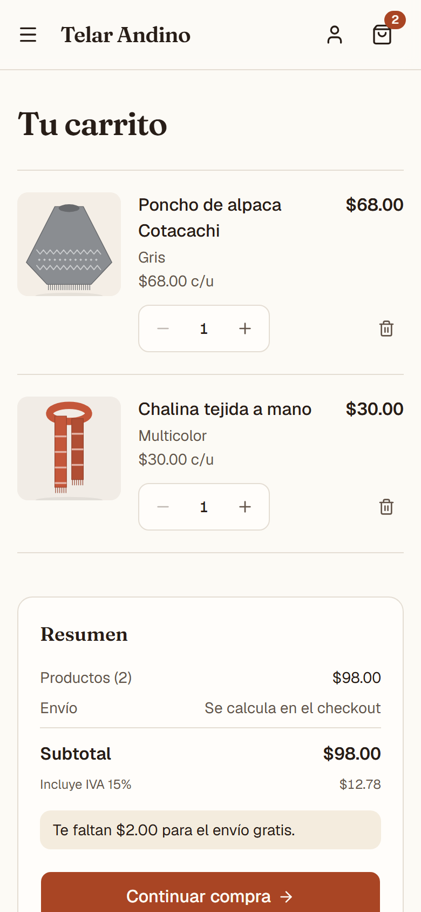
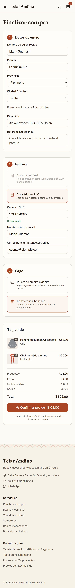
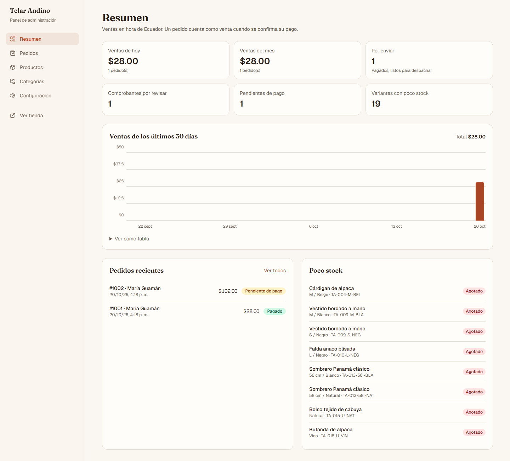
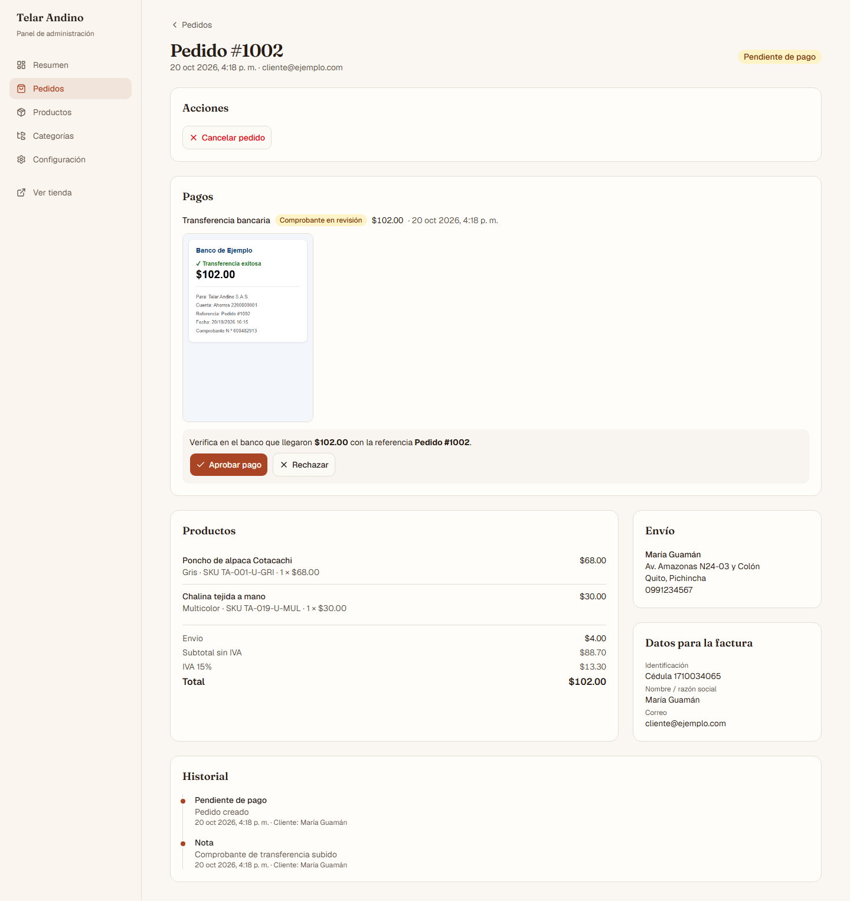
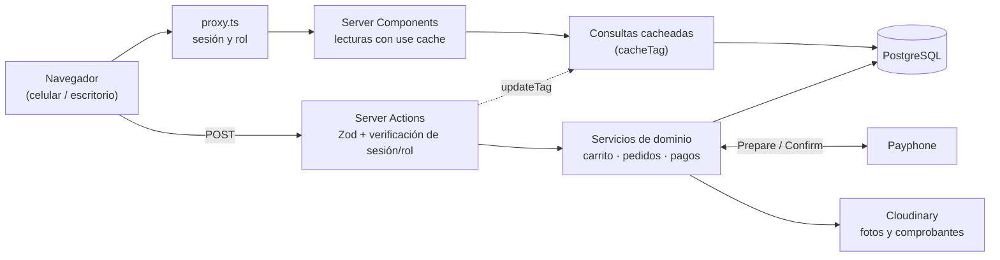

# Telar Andino — tienda en línea para una pyme ecuatoriana

Tienda en línea completa para un negocio de ropa y accesorios artesanales de Otavalo: catálogo, carrito, checkout con las reglas de Ecuador (provincias y cantones, IVA 15 %, cédula/RUC, consumidor final), pagos con **Payphone** o **transferencia con comprobante**, y un panel de administración para el día a día del negocio.

Pensada primero para el celular, que es desde donde compra la mayoría.

      

> **Demo en vivo:** _pendiente de publicar_ · Los pagos son simulados y los datos se reinician cada noche.
>
> | Rol | Correo | Contraseña |
> | --- | --- | --- |
> | Administrador | `admin@telarandino.ec` | `Admin123!` |
> | Cliente | `cliente@ejemplo.com` | `Cliente123!` |



| Catálogo | Producto | Carrito | Checkout |
| --- | --- | --- | --- |
|  |  |  |  |

| Panel: resumen | Panel: revisar un comprobante |
| --- | --- |
|  |  |

---

## Qué incluye

**Para el cliente**
- Catálogo con búsqueda, filtros por categoría y precio, orden y paginación; URLs amigables (`/categoria/sombreros`, `/productos/poncho-alpaca-cotacachi`).
- Ficha de producto con galería, variantes de talla y color, y stock en tiempo real ("¡Quedan solo 3!").
- Carrito que persiste al recargar y se fusiona con la cuenta al iniciar sesión.
- Checkout con las 24 provincias y 221 cantones, costo de envío por provincia, envío gratis desde un monto, y desglose de subtotal sin IVA, IVA 15 % y total en USD.
- Factura a consumidor final o con **cédula/RUC validados con su dígito verificador** (sobre $50 el SRI exige identificación y el checkout lo aplica).
- Pago con tarjeta vía **Payphone** o por **transferencia**: datos bancarios con botón de copiar y subida del comprobante (foto o PDF).
- Historial de pedidos con su estado y número de guía, y botón flotante de WhatsApp.

**Para el dueño de la tienda (`/admin`)**
- Resumen: ventas del día y del mes en hora de Ecuador, pedidos por pagar, comprobantes por revisar, pedidos por enviar, variantes con poco stock y gráfico de 30 días.
- Pedidos: aprobar o rechazar comprobantes (con motivo), marcar como enviado (con guía), entregado o cancelado. Cancelar un pedido pagado devuelve el stock.
- Productos con variantes, imágenes (portada, orden, color asociado) y stock; categorías.
- Configuración: nombre, logo, IVA, envío gratis, costos por provincia y cuentas bancarias.

**Calidad**
- Server Components y Server Actions; validación con Zod en el navegador y en el servidor.
- SEO: metadata y canonical por página, imágenes Open Graph generadas (foto, nombre y precio al compartir por WhatsApp), `sitemap.xml`, `robots.txt` y datos estructurados de producto, migas de pan y tienda.
- Accesibilidad WCAG 2.1 AA auditada con axe en cada corrida de pruebas.
- Seguridad probada con ataques reales: ver [docs/SEGURIDAD.md](docs/SEGURIDAD.md).

## Stack

Next.js 16 (App Router, Cache Components) · TypeScript · Tailwind CSS 4 · shadcn/ui · PostgreSQL 17 · Prisma 7 · Auth.js v5 · Zod 4 · Vitest · Playwright · Cloudinary · Payphone · Vercel + Neon.

## Arquitectura



```
src/
├─ app/                 rutas: (tienda), admin, api (auth, retorno de Payphone, comprobantes, cron)
├─ components/          UI de la tienda, del panel y shadcn/ui
├─ lib/
│  ├─ domain/           lógica pura y testeada: dinero, carrito e IVA, cédula/RUC, estados del pedido
│  ├─ validations/      esquemas Zod compartidos entre navegador y servidor
│  ├─ data/ecuador.ts   provincias y cantones (INEC)
│  └─ seo/              JSON-LD seguro
└─ server/              solo servidor: consultas, Server Actions, servicios, auth, pagos, almacenamiento
prisma/                 schema, migraciones y seed (20 productos con imágenes SVG generadas)
tests/                  unit · integration · e2e
docs/                   seguridad y capturas
```

### Decisiones que se pueden defender ante un cliente

| Decisión | Por qué |
| --- | --- |
| Dinero en centavos (`Int`) y precios con IVA incluido (PVP) | Sin errores de punto flotante. La Ley de Defensa del Consumidor exige mostrar el precio final; el IVA se desglosa en el checkout y siempre suma exactamente el total. |
| El pedido guarda una copia de precios, dirección y tasa de IVA | Si mañana cambia un precio o el IVA, el historial y las facturas siguen mostrando lo que se cobró. |
| Stock descontado al confirmar el pago, en una transacción con `UPDATE … WHERE stock >= n` | Dos compras simultáneas de la última unidad nunca dejan el stock en negativo. La confirmación es idempotente: recargar la página de pago no cobra ni descuenta dos veces. |
| El pago con tarjeta se confirma desde el servidor | No se confía en los parámetros de la URL de retorno: se consulta a Payphone y se verifica que la transacción y el monto coincidan. |
| Verificación de permisos junto a los datos | Cada consulta y acción del panel verifica el rol leyéndolo de la base de datos. El proxy redirige, pero no es la única barrera (un layout tampoco protege una página). |
| Cache Components con etiquetas | El catálogo se sirve prerenderizado y cada cambio del admin invalida solo lo que tocó (`updateTag`). |
| Comprobantes en almacenamiento privado | Tienen datos bancarios: nunca tienen URL pública y solo los ven el dueño del pedido o un admin. |

## Pruebas

| Tipo | Qué cubre | Cantidad |
| --- | --- | --- |
| Unitarias (Vitest) | Carrito e IVA, envío, cédula y RUC, cantones, estados del pedido, fechas en hora de Ecuador, validaciones, open redirect, archivos, JSON-LD | 242 |
| Integración (Vitest + Postgres real) | Carrito (IDOR, precios), pedidos, descuento de stock con concurrencia e idempotencia, Payphone, transferencias, panel, rate limiting, login | 80 |
| E2E (Playwright, build de producción, celular) | Flujo completo de compra, panel, SEO, accesibilidad (axe) y ataques reales: CSRF, XSS, IDOR, fuerza bruta, pagos falsificados, acciones de admin sin rol, archivos disfrazados | 55 |

```bash
npm test               # unitarias + integración (crea y migra la base tienda_test)
npm run test:e2e       # E2E (siembra tienda_e2e, compila y levanta en el puerto 3100)
npm run audit:prod     # vulnerabilidades en dependencias de producción
```

El test principal, [`tests/e2e/purchase-flow.spec.ts`](tests/e2e/purchase-flow.spec.ts), recorre una compra real: buscar, elegir variante, carrito, crear cuenta, checkout con cédula, transferencia y comprobante; luego el admin aprueba, despacha y entrega, y el cliente lo ve en su historial.

## Cómo correrlo localmente

Requisitos: Node.js 22+ y Docker Desktop.

```bash
npm install                 # instala y genera el cliente de Prisma
cp .env.example .env        # completa AUTH_SECRET:  npx auth secret
npm run db:up               # PostgreSQL 17 en Docker (puerto 5433)
npm run db:migrate          # migraciones
npm run db:seed             # 20 productos, 6 categorías y usuarios de prueba
npm run dev                 # http://localhost:3000
```

En local los pagos con tarjeta usan una pasarela simulada (`PAYPHONE_MODE="mock"`) y las imágenes se guardan en `uploads/`.

| Script | Descripción |
| --- | --- |
| `npm run dev` / `build` / `start` | Desarrollo, build y servidor de producción |
| `npm run typecheck` / `lint` | TypeScript y ESLint |
| `npm run db:studio` | Explorar la base con Prisma Studio |
| `npm run screenshots` | Regenera las capturas de este README |

## Despliegue (Vercel + Neon + Cloudinary)

1. **Neon**: crea un proyecto en la región `us-east-1` (cerca de Vercel). Copia la URL *pooled* (con `-pooler`) y la *directa*.
2. **Cloudinary**: crea una cuenta gratuita y copia *cloud name*, *API key* y *API secret*.
3. **Vercel**: importa el repositorio y configura las variables:

   | Variable | Valor |
   | --- | --- |
   | `DATABASE_URL` | URL pooled de Neon |
   | `DIRECT_URL` | URL directa de Neon (la usan las migraciones) |
   | `AUTH_SECRET` | `npx auth secret` |
   | `NEXT_PUBLIC_SITE_URL` | URL pública, p. ej. `https://telar-andino.vercel.app` |
   | `STORAGE_DRIVER` | `cloudinary` |
   | `CLOUDINARY_CLOUD_NAME`, `CLOUDINARY_API_KEY`, `CLOUDINARY_API_SECRET` | de Cloudinary |
   | `PAYPHONE_MODE` | `live` con credenciales de Payphone, o `mock` solo para la demo |
   | `PAYPHONE_TOKEN`, `PAYPHONE_STORE_ID` | de la consola de desarrolladores de Payphone |
   | `NEXT_PUBLIC_DEMO_MODE`, `CRON_SECRET` | `true` y un secreto largo, solo para la demo pública |

   El build ejecuta `vercel-build`: aplica las migraciones (`prisma migrate deploy`) y compila.
4. **Datos iniciales**: `DATABASE_URL=<url directa> npm run db:seed` desde tu equipo.
5. **Payphone**: registra `https://<tu-dominio>/api/pagos/payphone/retorno` como URL de respuesta.

### Modo demo

Con `NEXT_PUBLIC_DEMO_MODE=true` se muestra un aviso de tienda ficticia, las credenciales aparecen en el login, el panel bloquea subidas de archivos y cambios sensibles (datos bancarios, contacto, eliminar productos), y `vercel.json` programa un reinicio diario de los datos (`/api/cron/reset-demo`, protegido con `CRON_SECRET`).

## Limitaciones y próximos pasos

- **Facturación electrónica del SRI**: hoy el pedido guarda los datos de facturación; el siguiente paso es emitir el comprobante electrónico con un proveedor autorizado.
- **Correos transaccionales** (confirmación de pedido, envío) y verificación del correo al registrarse.
- **Pedidos sin pagar**: no expiran solos; una tarea programada podría cancelarlos y liberar el carrito.
- El driver de Cloudinary sigue el SDK oficial, pero se valida contra una cuenta real al desplegar.

---

*Telar Andino es una marca ficticia creada para este proyecto de portafolio. Las imágenes de productos son ilustraciones generadas.*
